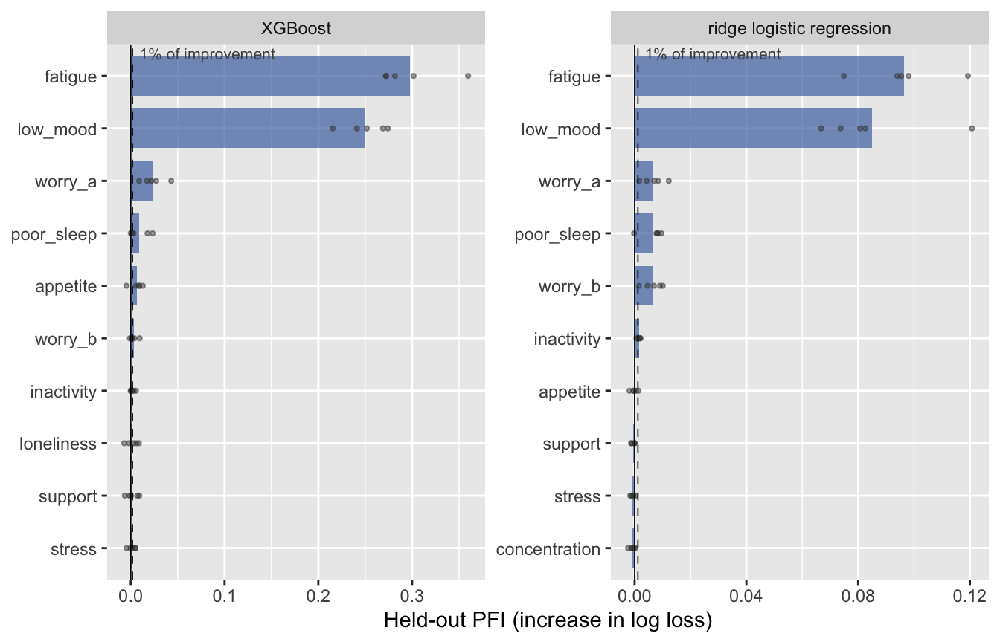

<!-- README.md is generated from README.Rmd. Please edit that file -->

# mlr3autoiml

`mlr3autoiml` helps researchers decide whether the evidence supports a
conclusion that they draw from an explanation of a machine learning
model, such as “the model relies mainly on self-rated health.” It
implements **Claim-Scoped Diagnostic Gates (CSDG)** for the **mlr3
ecosystem**. An analysis runs in its usual order:

1.  **Fit** learners and a model without predictors on the same
    cross-validation splits with `mlr3::benchmark()` (`csdg_fit()`).
2.  **Look** at held-out permutation feature importance (PFI), also
    grouped and conditional (`csdg_importance()`), at
    leave-one-covariate-out (LOCO) importance (`csdg_loco()`), or at
    accumulated local effects (`csdg_effect()`).
3.  **State a claim** that the result suggests (`claim_relies_mainly()`,
    `claim_top_k()`, `claim_order()`, `claim_direction()`); the package
    writes the claim and its six scope elements (Steps 1 and 2 of the
    article).
4.  **Check it**: the package derives the properties that the claim
    requires from the 12 gates of the article and computes the default
    checks (`csdg_check()`; Steps 3 and 4).
5.  **Assess it** with a fixed decision rule (`csdg_assess()`; Step 5)
    and test it on new data with the same criteria (`csdg_confirm()`).

The package writes the claim, its scope, the criteria, and the
observations from the computations. Properties that cannot be computed
are judged by the researcher with `csdg_judge()`: always measurement and
data (G0b), which stays open until judged, and validity evidence when a
claim names constructs. Favorable results never offset a contradicted
property, and no aggregate score is computed. Every claim derived,
checked, assessed, or tested in a session is logged
(`csdg_claim_log()`), so that all claims checked can be reported.
Claims, scopes, and evidence can also be recorded by hand
(`csdg_claim()`, `csdg_evidence_record()`, `csdg_adjudicate_claim()`).

| Term | Values |
|----|----|
| Scope elements | quantity, model, procedure, data, meaning (model description, population claim, causal claim), use |
| How a result enters the assessment (field `role`) | required property, established counterevidence, unresolved threat, context |
| Status of a required property | supported, contradicted, open |
| Assessment of a claim | not met if a required property is contradicted; otherwise unresolved if one is open; otherwise met |
| Decision | a met claim is retained; a claim that is not met or unresolved is revised or withheld |

## Installation

Install the current version from GitHub:

``` r
remotes::install_github("coorsaa/mlr3autoiml", dependencies = TRUE, build_vignettes = TRUE)
library(mlr3autoiml)
```

`dependencies = TRUE` also installs the suggested packages that the
examples and vignettes use, such as xgboost, glmnet, and mlr3learners.
Released versions are tagged, for example
`remotes::install_github("coorsaa/mlr3autoiml@v0.3.0", dependencies = TRUE)`.

## Quick start

A simulated survey of 1,000 respondents has 12 items and a binary
outcome. Two scale scores, `low_mood` and `fatigue`, predict it
strongly, with an interaction; `worry_a` and `worry_b` are two wordings
of one worry item; three items have weak effects and five none.

``` r
library(mlr3)
library(mlr3learners)
library(mlr3autoiml)
library(data.table)

simulate_survey = function(n, seed) {
  set.seed(seed)
  items = c("low_mood", "fatigue", "worry_a", "worry_b", "poor_sleep", "stress", "loneliness", "inactivity",
    "appetite", "concentration", "support", "optimism")
  x = as.data.table(matrix(rnorm(n * 12), n, 12, dimnames = list(NULL, items)))
  worry = rnorm(n)
  x[, worry_a := as.integer(cut(worry + rnorm(n, sd = 0.3), c(-Inf, -1.2, -0.4, 0.4, 1.2, Inf)))]
  x[, worry_b := pmin(5L, pmax(1L, worry_a + ifelse(runif(n) < 0.02, sample(c(-1L, 1L), n, TRUE), 0L)))]
  eta = -0.5 + 1.2 * x$low_mood + 1.1 * x$fatigue + 1.5 * x$low_mood * x$fatigue + 0.7 * worry +
    0.5 * x$poor_sleep + 0.2 * x$stress + 0.15 * x$loneliness
  x[, low_wellbeing := factor(rbinom(n, 1, plogis(eta)), levels = c(0, 1))]
  as_task_classif(x, target = "low_wellbeing", positive = "1", id = "survey")
}
task = simulate_survey(1000L, seed = 3L)
```

**Fit and look.** XGBoost and ridge logistic regression are fitted on
the same five folds as a model without predictors; XGBoost predicts
better on held-out data, because it represents the interaction. Held-out
PFI is the increase in held-out log loss when one predictor is permuted.
Common learners are labeled by their method in all generated text.

``` r
learners = list(
  xgboost = lrn("classif.xgboost", nrounds = 100, eta = 0.1, max_depth = 3, predict_type = "prob"),
  ridge = lrn("classif.cv_glmnet", alpha = 0, nfolds = 5, predict_type = "prob")
)
fits = csdg_fit(task, learners, folds = 5, seed = 1)
fits
#> <CSDGFits> survey: binary classification, 1,000 rows, 12 predictors, outcome low_wellbeing (positive class 1)
#>   5-fold cross-validation; the same splits for all learners and the model without predictors (seed 1)
#>   Loss for PFI and improvement: log loss (classif.logloss)
#>   learner                    classif.logloss      classif.auc      classif.acc
#>   XGBoost                              0.490            0.824            0.774
#>   ridge logistic regression            0.549            0.794            0.756
#>   model without predictors             0.667            0.500            0.619
imp = csdg_importance(fits, repetitions = 10, seed = 2)
imp
#> <CSDGImportance> held-out PFI, increase in log loss; 5 folds x 10 permutations
#> XGBoost: held-out log loss 0.490; model without predictors 0.667
#>   improvement 0.177; minimum importance (1% of the improvement) 0.0018
#>   predictor    mean PFI   corrected 95% interval   folds in top 2
#>   fatigue         0.297           [0.229, 0.366]              5/5
#>   low_mood        0.250           [0.206, 0.294]              5/5
#>   worry_a        0.0237        [-0.0001, 0.0474]              0/5
#>   poor_sleep     0.0091        [-0.0108, 0.0290]              0/5
#>   appetite       0.0063        [-0.0061, 0.0187]              0/5
#>   worry_b        0.0030        [-0.0045, 0.0105]              0/5
#>   ... 6 more predictors
#> ridge logistic regression: held-out log loss 0.549; model without predictors 0.667
#>   improvement 0.118; minimum importance (1% of the improvement) 0.0012
#>   predictor    mean PFI   corrected 95% interval   folds in top 2
#>   fatigue        0.0963          [0.0669, 0.126]              5/5
#>   low_mood       0.0849          [0.0458, 0.124]              5/5
#>   worry_a        0.0067        [-0.0007, 0.0142]              0/5
#>   poor_sleep     0.0067        [-0.0006, 0.0140]              0/5
#>   worry_b        0.0065         [0.0000, 0.0129]              0/5
#>   inactivity     0.0015         [0.0004, 0.0026]              0/5
#>   ... 6 more predictors
#> Folds in top 2: folds in which the predictor has one of the 2 largest PFI
#> values (print(x, k = )).
#> Intervals are reported descriptively. The minimum importance, the default
#> criterion of csdg_check(), is given in log loss units, because PFI values are
#> not parts of the improvement.
```

``` r
plot(imp)
```



**Claim, check, and assess.** The result suggests that XGBoost relies
mainly on `fatigue` and `low_mood`. `claim_relies_mainly()` states the
claim, `csdg_check()` computes the properties that it requires, and
`csdg_assess()` applies the decision rule. Whether the data cover what
the claim names (G0b) cannot be computed, so the researcher judges it,
here from the codebook; without the judgment, the claim stays
unresolved.

``` r
claim = claim_relies_mainly(imp, k = 2, factor = 2, learners = "xgboost")
g0b = csdg_judge("G0b", supported(), note = "Items and outcome coded as in the codebook; no missing values.")
chk = csdg_check(claim, imp, judgments = g0b)
chk
#> <CSDG check> XGBoost relies mainly on fatigue and low_mood.
#> Criteria (defaults, see ?csdg_check): minimum importance 1% of the improvement;
#> at least 5 of 5 folds; Monte Carlo rule; corrected 95% interval must clear the
#> smallest relevant difference.
#> gate  check               status        observation
#> G0a   specification       supported     Generated from the analysis: quantity,
#>                                         model, procedure, data, meaning (model
#>                                         description), and use.
#> G0b   measurement         supported     Judged by the researcher: Items and
#>                                         outcome coded as in the codebook; no
#>                                         missing values.
#> G1    performance         context       Held-out log loss 0.490 versus 0.667
#>                                         for the model without predictors
#>                                         (improvement 0.177, a reduction by
#>                                         27%); 5 of 5 folds improve.
#> G2    dependence          context       R^2 on the other 11 predictors: fatigue
#>                                         .01 and low_mood .01; no named
#>                                         predictor reaches .50.
#> G2    content             supported     fatigue 0.297 and low_mood 0.250 versus
#>                                         0.0237 for worry_a, the largest other
#>                                         predictor (12.6 and 10.6 times); margin
#>                                         (PFI minus 2 x PFI of worry_a) 0.250
#>                                         [0.209, 0.292] and 0.203 [0.113,
#>                                         0.293]; weakest of the 20 comparisons
#>                                         with other predictors: low_mood minus 2
#>                                         x worry_a, 0.203 [0.113, 0.293].
#>                                         Against the largest other predictor of
#>                                         each fold, which can differ between
#>                                         folds: 0.249 [0.208, 0.291] and 0.202
#>                                         [0.112, 0.292].
#> G2    minimum importance  supported     fatigue 0.297 and low_mood 0.250 versus
#>                                         the minimum importance 0.0018 (1% of
#>                                         the improvement of 0.177, from 0.667 to
#>                                         0.490).
#> G2    procedure           supported     Held-out marginal PFI with log loss, 10
#>                                         permutations per fold in 5 folds, as
#>                                         the scope names. No grouped or
#>                                         conditional comparison was requested.
#> G5    stability           supported     Selected anew in each fold: 5 of 5
#>                                         folds reproduce the result (cutoff 1: 0
#>                                         of 5; cutoff 3: 2 of 5).
#> G6a   other learner       context       ridge logistic regression: the result
#>                                         also holds (fatigue 0.0963 and low_mood
#>                                         0.0849 versus 0.0067 for worry_a).
csdg_assess(chk)
#> <CSDG assessment> XGBoost relies mainly on fatigue and low_mood.
#>   Met (exploratory)
#>   Specification (G0a) supported | Measurement and data (G0b) supported |
#>   Content (G2) supported | Minimum importance (G2) supported | Procedure (G2)
#>   supported | Stability (G5) supported
#>   On average, fatigue and low_mood have 12.6 and 10.6 times the PFI of the
#>   largest other predictor, worry_a; the result recurs in 5 of 5 folds. The
#>   claim was formulated after the explanation was inspected; it is established
#>   only after a test on new data (csdg_confirm()).
#>   Decision options: retain
```

The claim was formulated after the explanation was inspected, so its
assessment is exploratory; `csdg_confirm(chk, new_task)` fits the same
learners to new data and applies the claim with the same criteria.

## Learn more

- **[From an explanation to a checked
  claim](https://stefancoors.de/mlr3autoiml/articles/exploratory_workflow.html)**
  (`vignette("exploratory_workflow", package = "mlr3autoiml")`) works
  through the five steps with the simulated survey on ten folds: a claim
  that is met, a claim about the two wordings of the worry item, which
  is unresolved with marginal PFI and not met once conditional PFI shows
  that neither wording adds information beyond the other (the procedure
  property, G2, is contradicted), a direction, the test on new data, and
  the claim log.
- **[The numerical example of the
  article](https://stefancoors.de/mlr3autoiml/articles/claim_scoped_diagnostic_gates.html)**
  (`vignette("claim_scoped_diagnostic_gates", package = "mlr3autoiml")`)
  assesses the two claims of the article’s numerical example and the
  unqualified variant that shows why the qualifier is needed.
- **[The function
  reference](https://stefancoors.de/mlr3autoiml/reference/index.html)**
  documents every function, including the diagnostics of `csdg_audit()`
  and the local surrogate described in `?csdg_diagnostics`.
- `csdg_claim_record_template()` returns the blank claim record of the
  article as a table to fill in, and `supported()`, `contradicted()`,
  and `open_status()` return the three property statuses.
- Labels of versions before 0.1.6 still work with a deprecation warning;
  see [the migration
  note](https://github.com/coorsaa/mlr3autoiml/blob/main/inst/MIGRATION_0_1_6.md)
  and [the
  changelog](https://stefancoors.de/mlr3autoiml/news/index.html).

## Diagnostics in an mlr3 workflow

`csdg_audit()` derives the gate plan and computes the diagnostics of an
mlr3 learner: held-out performance, dependence and support, calibration,
decision curves, cross-validated local fidelity, stability of held-out
PFI, comparisons with similarly accurate models, leave-one-setting-out
refits, and subgroup results. `csdg_report_card()` lists the gates with
the status of each required property, and `csdg_claim_report()` applies
the decision rule to the audit and to evidence records that the
researcher supplies. A numerical criterion needs a source and a
rationale; without them, the property remains open. By default,
`csdg_export()` omits fitted models and observation-level predictions;
review the generated bundle before sharing it.

## The accompanying article

Version 0.1.0 produced the initial analyses of the accompanying article.
The scripts of its two empirical applications are kept in a separate
analysis repository.

## Legacy AutoIML workflow

The earlier `AutoIML` interface remains available for compatibility. Its
gate identifiers and pass/warn/fail/skip labels are separate from the
CSDG gate registry and vocabulary. Its examples and gate overview are in
[the legacy AutoIML
article](https://stefancoors.de/mlr3autoiml/articles/legacy_autoiml.html)
(`vignette("legacy_autoiml", package = "mlr3autoiml")`); new analyses
start from the CSDG interface above.

## License

LGPL-3.
